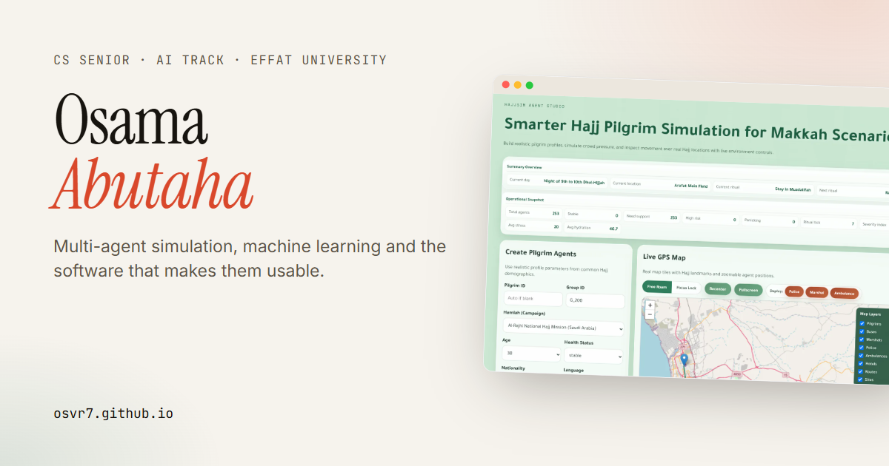

# Osama Abutaha · Portfolio

Personal portfolio of **Osama Abutaha**, a Computer Science senior (AI track) at Effat University.
Live at **[osvr7.github.io](https://osvr7.github.io/)**.



## What's inside

- **Home** (`index.html`): hero, three featured projects, a filterable and searchable collection of all projects, about, experience and leadership, skills (each mapped to the project where it was used), education and contact.
- **Case studies** (`project.html?p=<slug>`): problem, solution, features, architecture, results, challenges, my exact contribution, and a screenshot gallery with a lightbox.
- Light and dark themes (follows the system setting, remembers your choice), keyboard-friendly navigation, reduced-motion support, Open Graph and structured data.

## How it's built

Plain HTML, CSS and JavaScript. There is no framework and no build step.

```text
index.html          Home page
project.html        Case study template
css/style.css       Design tokens (light/dark), layout and components
js/data.js          All profile and project content, kept separate from the UI
js/main.js          Shared behaviour and home page rendering
js/project.js       Case study rendering
images/projects/    Optimised WebP screenshots and diagrams, one folder per project
```

To add or edit a project, change `js/data.js`. The home page cards and the case study render from it.
Set `repo` to a GitHub URL once a repository is published. While it is `null`, the site shows "Repository coming soon" instead of a broken link.

## Run locally

```bash
python -m http.server 5500
```

Then open <http://127.0.0.1:5500>.

## Content policy

Every project description, metric and screenshot comes from the actual project source code, reports or commit history. Screenshots were captured from the running applications or exported from the original project files. Team members are credited on each case study.
